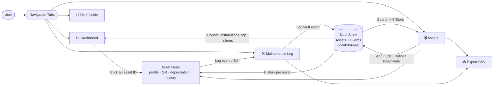
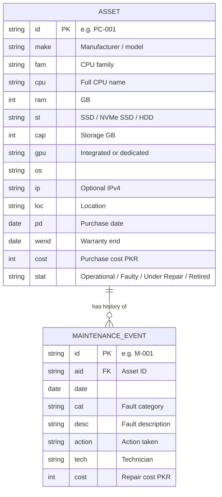
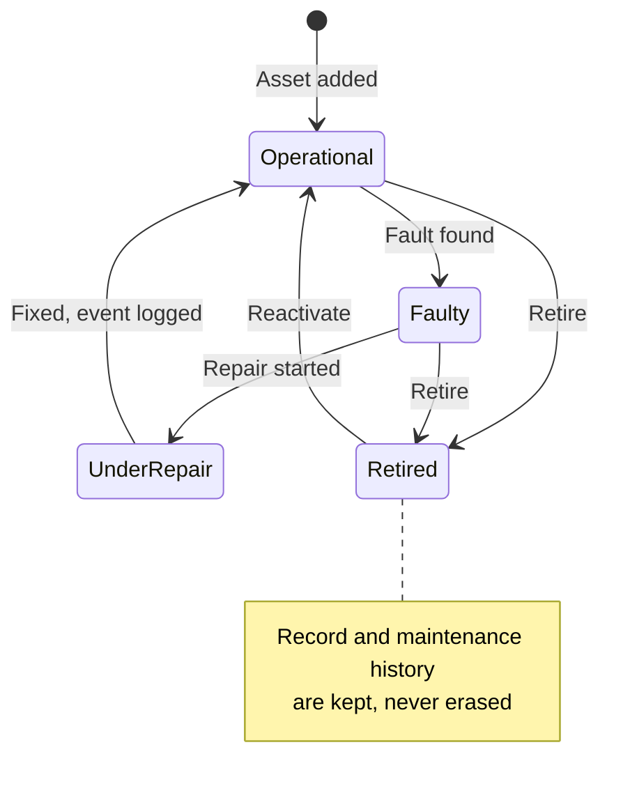
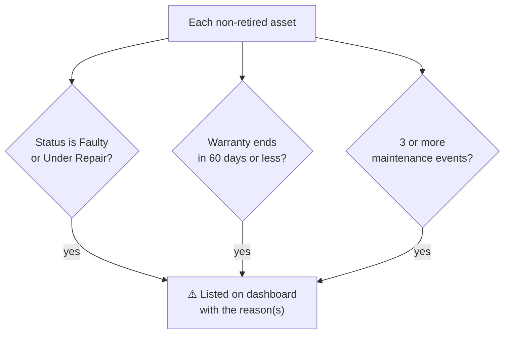

# EF101-P11: Computer Hardware Inventory & Maintenance System

**Course:** EF-101 · Fall 2026 · System Understanding Projects
**Project ID:** EF101-P11 · **Submission:** Week 13, Monday 9 November 2026
**Group members:** _Syed Ayaan (18)_ · _Mujtaba Ahmed (27)_ · _Hammad Tariq (37)_

🔗 **Live demo:** [https://alemmorr.github.io/EF-101-HARDWARE-INVENTORY/](https://htmlpreview.github.io/?https://github.com/alemMORR/EF-101-HARDWARE-INVENTORY/blob/main/index_FIXED_add-edit-asset.html](https://raw.githack.com/alemMORR/EF-101-HARDWARE-INVENTORY/main/index_FIXED_add-edit-asset.html))
📦 **Run locally:** download `index.html` and double-click it. No installation, server or internet is needed (except the QR image, see Limitations).

---

## 1. Project Summary

A single-page web application that manages the computing assets of a lab, department or small company. It keeps one trustworthy record per machine, logs every fault and repair, and turns that data into a dashboard that answers **"what needs attention?"**

The system connects hardware knowledge (CPU, RAM, storage, GPU, warranty) with database ideas (records, relationships, validation, search, export).

## 2. Visual Schema of the Project

### 2.1 System Overview



### 2.2 Data Model (Entity Relationship)



### 2.3 Asset Lifecycle



### 2.4 "Requires Attention" Logic



## 3. Requirements Coverage

| Project requirement | Where it is implemented |
|---|---|
| Mandatory asset fields (ID, model, CPU, RAM, storage, GPU, OS, IP, location, purchase date, warranty, status) | Asset record and Add/Edit form |
| Add, edit, search, retire/deactivate | Assets tab, `formA()`, `saveA()`, retire/reactivate actions |
| At least 30 demo records | **32 assets** generated by `seed()` |
| Maintenance events (date, fault, action, technician, cost) | Maintenance tab, `formE()`, `saveE()` (**28** sample events) |
| Maintenance history per asset | Asset detail view, `viewA()` + `evTable()` |
| Search / filter by CPU family, RAM, storage, location, status, warranty | `filt()` with search box + 6 dropdown filters |
| Dashboard (total, operational, faulty, out of warranty, needs attention) | `vDash()` KPI cards |
| Hardware distribution chart | RAM, storage type and CPU family bar charts (`bars()`) |
| Most frequently failing asset / fault category | `tally()` on events, shown in the dashboard |
| Export | `csv()` + `downloadCSV()` for inventory and maintenance data |

**Bonus / extension features included**

- 🏷️ **QR asset labels** in every asset detail view
- 📉 **Age and depreciation** widget (5-year lifecycle)
- ✅ **Input validation** (unique ID, valid IPv4, no future dates, warranty after purchase)
- 🌗 Automatic light/dark theme, mobile-friendly layout

## 4. Main Code Segments

The whole application lives in one file, `index.html`, in three parts: HTML shell, CSS, and JavaScript.

| Segment | What it does |
|---|---|
| `seed()` | Builds 32 sample assets from 8 hardware configurations and 28 maintenance events, used on first launch. |
| `load()` / `save()` | Reads and writes all data to the browser's `localStorage`, so changes survive a refresh. |
| `render()` | Draws the active tab (`vDash`, `vAssets`, `vMaint`, `vGuide`). Every view is built from the current data. |
| `vDash()` | Calculates KPIs, distributions, top failing asset and category, and the attention list. |
| `reasons()` | Decides why an asset needs attention (status, warranty close to ending, repeated repairs). |
| `filt()` | Combines the search text and all dropdown filters to produce the asset list. |
| `formA()` / `saveA()` | Add/edit form with validation of every field before saving. |
| `formE()` / `saveE()` | Maintenance form; also lets the technician update the asset's resulting status. |
| `viewA()` | Asset detail: specs, QR label, depreciation, history and total repair cost in one place. |
| `calcDepreciation()` | Straight-line value over 5 years from purchase date and cost. |
| `csv()` / `downloadCSV()` | Converts data to CSV and downloads it. |
| Event listeners | One click, input, change and submit handler (event delegation using `data-a` attributes). |

## 5. Hardware Concepts Behind the Fields

| Field | Why an organization tracks it |
|---|---|
| **Asset ID** | Stable label for one physical machine, so history and warranty claims never get mixed up. Unlike an IP address, it does not change. |
| **IP address** | Network identity. It can change or be blank, so it is *not* used as the identifier. |
| **CPU** | Processing power. Family and model help plan upgrades and find compatible parts. |
| **GPU** | Graphics/compute for design, CAD or AI work. Many office PCs only have integrated graphics. |
| **RAM vs storage** | RAM is short-term working memory (multitasking). Storage is long-term space for files and the OS. |
| **SSD vs HDD** | SSD is faster and has no moving parts. HDD is cheaper per GB but slower and fails mechanically more often. |
| **Warranty** | Decides whether a repair is free or paid, and when to budget for replacement. |
| **Maintenance history** | Shows repeat failures, repair cost and fault patterns, supporting repair-or-replace decisions. |

## 6. Findings from the Sample Data

From the 32 sample assets and 28 maintenance events, the dashboard shows:

- **Most frequently failing fault category:** Storage, with 9 events.
- **Most frequently failing assets:** PC-007, PC-011 and PC-019 are tied with 3 events each. PC-007 is listed first.
- **Fleet health:** 31 active assets (1 retired), 26 operational, 5 faulty or under repair, 21 out of warranty, and 6 requiring attention.

Because storage faults are the largest group, a sensible next step is to review the oldest drives and schedule regular checks for repeat-failure machines.

## 7. Technologies

HTML5 · CSS3 (CSS variables, grid, dark mode) · Vanilla JavaScript (no frameworks) · Browser `localStorage` · Mermaid (diagrams in this README)

## 8. Repository Structure

```
.
├── index.html     # Complete application (HTML + CSS + JS)
├── README.md      # This report
└── docs/          # (optional) slides, screenshots
```

## 9. Limitations and Future Work

- Data is stored only in the user's browser, so it is not shared between computers. A backend (Node/SQL) would fix this.
- QR codes use the public `api.qrserver.com` service, so they need internet access.
- Possible extensions: spare-parts inventory, maintenance reminders, automatic spec import from a PC, authorised network discovery.

## 10. Team

| Name | Student ID | Contribution |
|---|---|---|
| _Syed Ayaan_ | _18_ | _Search and filters, asset detail view, maintenance log_ |
| _Mujtaba Ahmed_ | _27_ | _Retire/reactivate lifecycle, field guide, CSV exportg_ |
| _Hammad Tariq_ | _37_ | _Asset record and validation, navigation, dashboard_ |
